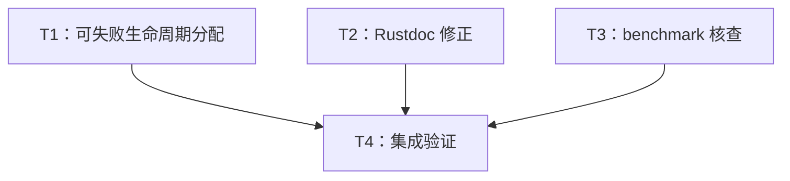

# rs-codec 本轮评审改进实施计划

> **面向智能体执行者：** 使用 executing-plans 按任务逐项执行，复选框记录进度。任务写入集合不相交时可按调度图并行；若采用子智能体执行，使用 subagent-driven-development 并遵循同一任务边界。此文档不是启动实施的命令，实际操作按后续实施命令授权执行。

**目标：** 修复生命周期临时缓冲失败路径、校正并补充 Rustdoc，并按证据处理旧 benchmark 疑点。

**架构：** 保留 Codec、engine、adapter、I/O bridge 与 registry 的现有分层。仅在 converter 两处采用已有可失败预留工具；文档修正与 benchmark 核查独立进行。

**技术栈：** Rust 1.94、edition 2024、qubit-utils、Cargo、Criterion、objdump/nm。

**设计依据：** [设计文档](design-20261030T035201346Z-e4e617a6.md)。

**工作位置：** `/data/working/qubit/rust-common/rs-codec`，使用用户当前 Paseo workspace。文档按用户指定路径保存在 doc 目录，没有临时计划工作区需要清理。

## 范围、约束与前置检查

纳入 RC2-001（已确认 P2）、RC2-002（已确认 P2）、RC2-003（已确认 P3）、RC-009（待验证 P2）；没有明确搁置或拒绝的条目。RC-009 先验证，再决定是否改 benchmark，不因纳入计划而视为已确认缺陷。

- 仅修改与当前任务直接相关的内容，不顺手重构、格式化或清理。
- CI 只验证当前 crate 自身，不加入或保留 downstream all-features 测试。
- 不需要改公开 API、现有 Default 约束、依赖、CI 配置或下游仓库。
- Rustdoc 使用英文；实施记录使用中文。读取实际适用的项目与 Rust 规则后再修改 Rust 文件。
- 不覆盖用户已有改动。开始时执行 `git status --short`、`git rev-parse HEAD` 并核对设计中的符号仍存在；如果位置漂移，按符号定位，不按旧行号盲改。
- 提交、推送等操作按后续实施命令及适用 Git 规则执行。本计划不预设必须提交才能解锁后续任务。

## 调度图

| 任务 | 前置任务 | 最小解锁产物 | 写入集合 | 本地验证 | 集成验证归属 | 审查时机 |
| --- | --- | --- | --- | --- | --- | --- |
| T1：可失败生命周期分配 | 无，批次 A | 无接口变更；两项公开入口回归及实现 | `src/transcode/engine/transcode_convert_engine.rs`、`tests/transcode/engine/mod.rs`、新增 `tests/transcode/engine/transcode_convert_engine_allocation_tests.rs` | 两个新测试及 converter 测试过滤 | T4 | 立即审查 |
| T2：Rustdoc 修正 | 无，批次 A | 两处完成的英文文档变更 | `src/codec/codec/codec.rs`、`src/lib.rs` | 源文与 manifest/guide 对照；构建由 T4 执行 | T4 | 批量审查 |
| T3：benchmark 核查 | 无，批次 A | 最终产物证据与三分支结论 | `benches/README.md`；仅确认缺陷时改 `benches/transcode.rs` | 精确 bench 构建、反汇编归属；条件性运行受影响 bench | T4（行为/文档门禁）；取证由 T3 独占 | 立即审查 |
| T4：集成验证 | T1、T2、T3 | 三项变更可用；RC-009 核查记录可用 | 默认无新增源码；必要时仅修正前三任务直接引入的问题 | 本 crate 统一门禁与最终 diff | T4 | 立即审查 |

批次 A 的写入集合互不相交，可并行；共享 target 资源组 R1 的 Cargo/编译重任务必须串行。T3 的 profiling 与测量必须避开其他本机编译或性能测量。T4 收齐三个任务产物后运行一次统一验证；发现新改动或失败才重跑相应检查。

## 任务拓扑依赖图



## T1：修复生命周期临时分配（RC2-001）

**文件与接口：** 修改 converter engine 的 `drain_decoder_reset`、`drain_decoder_finish` 及公共 reset/finish 的错误说明；不改函数签名。新增测试文件并在 `tests/transcode/engine/mod.rs` 加入 `mod transcode_convert_engine_allocation_tests;`。输出为既有 `TranscodeConvertError::Failure(TranscodeFailure::AllocationFailed)`，供 T4 集成验收。

- [ ] 阅读 `~/.agents/specs/bug-fix.mdc`、`rust-coding.mdc`、`rust-comment.mdc`、`rust-test.mdc`，以及适用的 systematic-debugging / test-driven-development 技能；本任务为原因明确的局部修复，不重新发起架构审批。
- [ ] 新建测试文件，使用项目标准文件头。以下测试通过公开 adapter 间接覆盖实际 engine，fixture 的 encode domain 为空，避免不符合契约的零宽丢弃行为：

```rust
use core::convert::Infallible;
use core::num::NonZeroUsize;

use qubit_codec::Codec;
use qubit_codec::CodecTranscodeConverter;
use qubit_codec::DecodeFailure;
use qubit_codec::TranscodeConvertError;
use qubit_codec::TranscodeFailure;

struct AllocationCodec<const RESET: usize, const FINISH: usize>;

impl<const RESET: usize, const FINISH: usize> Codec for AllocationCodec<RESET, FINISH> {
    type Value = u64;
    type Unit = u8;
    type DecodeError = Infallible;
    type EncodeError = Infallible;

    const MIN_UNITS_PER_VALUE: usize = 1;
    const MAX_DECODE_UNITS_PER_VALUE: usize = 1;
    const MAX_ENCODE_UNITS_PER_VALUE: usize = 0;
    const MAX_DECODE_RESET_VALUES: usize = RESET;
    const MAX_DECODE_FINISH_VALUES: usize = FINISH;

    fn can_encode_value(&self, _value: &u64) -> bool {
        false
    }

    unsafe fn decode(
        &mut self,
        input: &[u8],
        index: usize,
    ) -> Result<(u64, NonZeroUsize), DecodeFailure<Infallible>> {
        debug_assert!(index < input.len());
        Ok((u64::from(input[index]), NonZeroUsize::MIN))
    }

    unsafe fn encode(
        &mut self,
        _value: &u64,
        _output: &mut [u8],
        _index: usize,
    ) -> Result<usize, Infallible> {
        unreachable!("the encodable domain is empty")
    }
}

#[test]
fn test_convert_reset_allocation_failure_returns_error_and_poisoned_state() {
    let mut converter = CodecTranscodeConverter::new(
        AllocationCodec::<{ usize::MAX }, 0>,
        AllocationCodec::<0, 0>,
    );
    assert_eq!(Ok(0), converter.max_reset_output_len());
    assert!(matches!(
        converter.reset(&mut [], 0),
        Err(TranscodeConvertError::Failure(TranscodeFailure::AllocationFailed)),
    ));
    assert!(matches!(
        converter.finish(&mut [], 0),
        Err(TranscodeConvertError::Failure(TranscodeFailure::LifecyclePoisoned)),
    ));
}

#[test]
fn test_convert_finish_allocation_failure_returns_error_and_reset_recovers() {
    let mut converter = CodecTranscodeConverter::new(
        AllocationCodec::<0, { usize::MAX }>,
        AllocationCodec::<0, 0>,
    );
    converter.reset(&mut [], 0).expect("zero reset bound");
    assert_eq!(Ok(0), converter.max_finish_output_len());
    assert!(matches!(
        converter.finish(&mut [], 0),
        Err(TranscodeConvertError::Failure(TranscodeFailure::AllocationFailed)),
    ));
    assert!(matches!(
        converter.transcode(&[], 0, &mut [], 0),
        Err(TranscodeConvertError::Failure(TranscodeFailure::LifecyclePoisoned)),
    ));
    converter.reset(&mut [], 0).expect("reset recovers lifecycle");
    assert!(converter.transcode(&[], 0, &mut [], 0).unwrap().is_complete());
}
```

- [ ] 运行失败回归：`cargo test --locked --test tests transcode_convert_engine_allocation_tests`。预期两个测试因 `capacity overflow` panic 失败；若失败原因是 fixture、导入或注册错误，先修正测试，不把它当作缺陷证据。
- [ ] 在 engine 添加 `use qubit_utils::try_reserve_vec;`，reset 分支用下列代码替换原 `collect()`：

```rust
let mut reset_values = Vec::new();
try_reserve_vec(&mut reset_values, value_count)
    .map_err(|_| TranscodeFailure::allocation_failed())?;
reset_values.resize_with(value_count, D::Value::default);
```

- [ ] finish 分支替换为：

```rust
let mut decoded = Vec::new();
try_reserve_vec(&mut decoded, value_count)
    .map_err(|_| TranscodeFailure::allocation_failed())?;
decoded.resize_with(value_count, D::Value::default);
```

- [ ] 保留零值快速路径、target reset 优先顺序、pending 排出顺序和生命周期标记位置。在 reset/finish 的 Errors 文档补充：`Returns a framework allocation failure if the internal lifecycle value buffer cannot be reserved. Once lifecycle execution starts, failure leaves the converter poisoned until a later reset succeeds.` 不把 `Default` 本身的失败纳入可恢复保证。
- [ ] 重跑 `cargo test --locked --test tests transcode_convert_engine_allocation_tests`，预期 2 项通过；运行 `cargo test --locked --test tests transcode_convert_engine`，预期覆盖现有 converter/partition 测试且通过。
- [ ] 审查最小 diff：没有引入新公开 API、allocator 替换、实际巨量内存申请或无关格式化；交付 T4。

## T2：修正并补充 crate Rustdoc（RC2-002、RC2-003）

**接口与依赖：** 无 API 变更；读取 Cargo.toml、README 与两份 guide 作为事实来源。写入集合仅 `src/codec/codec/codec.rs` 和 `src/lib.rs`。文档构建统一由 T4 负责。

- [ ] 将 `MIN_UNITS_PER_VALUE` 的错误除数说明替换为下述英文，保留原有安全前置条件含义：

```rust
/// This is a lower bound used by checked callers for planning and fast
/// impossibility checks. If a streaming decoder has fewer than this many
/// readable units, no complete value can be present at the current
/// position. Default decode hooks conservatively use the input unit count
/// as their output bound: an invalid-input policy may consume fewer units
/// than a valid value and still emit one replacement value.
```

- [ ] 在 crate 首页 Overview 后添加英文 Features 节，内容如下。所有 feature-gated 名称使用代码字面量，不创建 default 构建下无效的符号链接：

```rust
//! # Features
//!
//! The default feature set is empty. Features are independent.
//!
//! | Feature | Capability |
//! | --- | --- |
//! | `io` | Synchronous and asynchronous buffered bridges for `qubit-io`. |
//! | `json` | Whole-value Serde JSON codecs for strings and bytes. Encoding requires `Serialize`; decoding requires `DeserializeOwned`. |
//! | `registry` | Static string-wire and bytes-wire codec registration, macros, and runtime lookup. Registrations cannot be added at runtime. |
//! | `json` + `registry` | Built-in registrations for `serde_json::Value` only. Custom DTOs require their own descriptor and unique registry ID. |
//!
//! See the [English user guide](https://github.com/qubit-ltd/rs-codec/blob/main/doc/user_guide.md)
//! or the [Chinese user guide](https://github.com/qubit-ltd/rs-codec/blob/main/doc/user_guide.zh_CN.md)
//! for setup, lifecycle handling, and registry examples.
```

- [ ] 对照实际 features、公开导出、用户指南检查表格事实；确认没有修改默认 hooks 公式，没有顺手重写 README/指南。由 T4 构建默认与 all-features Rustdoc。

## T3：benchmark 取证及条件性修复（RC-009）

**接口与写入：** 读取 `benches/transcode.rs` 和 Cargo bench profile；首先只取证。必需更新 `benches/README.md` 的核查状态；仅证据确认写入消失时改 `benches/transcode.rs`。不修改 Cargo.toml、CI、生产 engine 或独立 safe/unchecked 探针。

- [ ] 用 `mktemp -d /tmp/rs-codec-rc009.XXXXXX` 创建取证目录并记录实际绝对路径；所有原始构建记录、可执行文件副本和反汇编保存在该目录，核查报告记录保留位置。不要删除上一轮证据。
- [ ] 记录 `git rev-parse HEAD`、`git status --short`、`rustc -vV`、`lscpu`、Cargo bench profile，以及完整构建命令。确认同一主机没有并发编译和测量任务；无法排除争用时明确标注，不输出可靠性能比较。
- [ ] 在未修改计时逻辑时构建：`cargo bench --locked --bench transcode --no-run --message-format=json`，将 stdout/stderr 分别保存为取证目录的 `build.jsonl`、`build.stderr`。从 `reason == "compiler-artifact"`、target 名为 `transcode` 且 `executable` 非空的消息取得实际路径，不按文件名猜测。
- [ ] 立即复制该 executable 到取证目录 `transcode-before`，记录 SHA-256。执行 `objdump -Cd <实际 executable>` 和 `nm -C <实际 executable>`，分别保存反汇编与符号表。核查 direct、decode_engine、complete_lifecycle、codec_adapter 与旧窗口计时循环的完整写入；缺少归属证据时不得标为已确认消除。
- [ ] 如需行表帮助，使用单独的 `CARGO_TARGET_DIR=<取证目录>/target-debuglines` 及 `CARGO_PROFILE_BENCH_DEBUG=1` 构建相同 bench，保留原 LTO/优化设置。辅助构建仅协助定位；必须回到原 profile 最终产物验证。若仍不能对应，选择“仍待验证”分支。
- [ ] 根据设计三分支表裁决：完整写入已确认则保留源码；证据不足则保留疑点；确认写入消失才执行以下修复。两种不改源码分支均在 README 更新日期、基线、工具链、方法、覆盖路径和结论边界。
- [ ] 仅在确认缺陷的分支中，在每次 transcode 后加入完整输出观察，并保留已有计数观察：

```rust
black_box(&output[..progress.written()]);
```

  `codec_adapter` 使用 `adapter_output`，complete lifecycle 使用 `black_box(&output[..written]);`；旧窗口循环每一轮在缓冲复用前观察。safe_copy_loop 对照使用 `black_box(&safe_output[..input.len()]);`，移除被完整切片观察取代的单首元素观察，避免比较粒度不一致。保留不受影响路径；不改独立 `safe_vs_unchecked` 探针。

- [ ] 若修复发生，为受影响路径在计时外增加完整输出正确性检查。现有窗口 helper 可用于旧 CopyTranscoder，放在 bench 注册前且不改变 timed closure；完整路径在注册前调用一次 transcode 并 `assert_eq!(input, &output[..progress.written()]);`，complete 路径调用一次完整生命周期并检查完整切片。对生命周期被关闭的实例重新 reset 后才进入正式计时；保持分配在计时外。
- [ ] 若修改了 benchmark，重新保留 after executable 与归属证据，并运行受影响测量：`cargo bench --locked --bench transcode -- transcoder_complete`、`cargo bench --locked --bench transcode -- output_window`。预期外部正确性断言通过，Criterion 能报告新基线；不设不可靠的跨机性能阈值。不修改源码的分支不为了完成表格强行重跑耗时测量。
- [ ] 更新 `benches/README.md`：保留历史测量的日期与局限；写出新结论和取证路径。若改了观察方式，新旧数字不可被直接解释为生产性能提升。无证据时显式标记 RC-009 仍待验证及缺失的归属信息，交付 T4。

## T4：统一集成验收与交付

**输入：** T1 新错误路径及回归、T2 两处 Rustdoc、T3 取证记录和条件性变更。**输出：** 验证记录、最终 diff、四项逐项状态。没有新接口。

- [ ] 对照设计核查写入范围及任务产物；读取 verification-before-completion 的要求。确认 T1 的失败测试实际经历红→绿，T3 状态有证据支撑。
- [ ] 运行 `cargo fmt --all -- --check` 检查格式。若失败仅调整本次修改文件涉及的格式；不运行会批量改写无关文件的流程。工具若报告原有问题，应与本次变更区分。
- [ ] 统一运行本 crate 检查，记录每条命令和退出码：

```bash
cargo test --locked --workspace
cargo test --locked --workspace --all-features
cargo clippy --locked --workspace --all-targets --all-features -- -D warnings
```

- [ ] 使用当前 `.infra/ci/cargo-matrix.json` 的独立组合验证特性隔离。core-only 的 test 已由前一步覆盖，doc 由下一步覆盖；补充 core-only Clippy，再对四种独立组合执行现有 matrix 要求的 test/doc/clippy。命令串行，保持 matrix 配置不变：

```bash
cargo clippy --locked --workspace --all-targets --no-default-features -- -D warnings
for codec_features in registry io json json,registry; do
    cargo test --locked --workspace --no-default-features --features "$codec_features"
    RUSTDOCFLAGS='-D warnings' cargo doc --locked --workspace --no-deps --no-default-features --features "$codec_features"
    cargo clippy --locked --workspace --all-targets --no-default-features --features "$codec_features" -- -D warnings
done
```
- [ ] 严格文档构建：分别运行 `RUSTDOCFLAGS='-D warnings' cargo doc --locked --workspace --no-deps --no-default-features` 和 `RUSTDOCFLAGS='-D warnings' cargo doc --locked --workspace --no-deps --all-features`。预期无失效 intra-doc link 或警告；人工检查 Features 表和两份指南链接与正文一致。
- [ ] 检查 CI diff 与 Cargo.lock，没有引入 downstream all-features 测试或无关依赖变更。已有基础设施完整门禁若由后续实施命令要求，先检查其范围，再运行；不得为满足本计划改写 CI。
- [ ] 最终逐项报告：RC2-001 两处错误及 poisoned/recovery 行为；RC2-002 文档公式；RC2-003 feature 导航；RC-009 是已排除、已确认并修复、或仍待验证。证据不足不标修复成功。说明实际测试范围和未运行项目，不用源码审查替代测试证据。

## 需求与验收映射

| 设计要求 | 任务 | 可观察验收 |
| --- | --- | --- |
| 全部四项纳入、无拒绝条目 | T1—T4 | 四项状态均在交付报告中列出 |
| 可恢复分配与最小修改 | T1、T4 | 两个回归从 panic 变为 AllocationFailed，零输出路径不额外分配 |
| 保留生命周期语义 | T1、T4 | 失败后 poisoned，finish 失败后的成功 reset 可恢复 |
| 文档公式与实现一致 | T2、T4 | 不再声称默认解码容量按最小宽度相除 |
| feature 接入及双语导航 | T2、T4 | default/all-features Rustdoc 均通过，组合限制准确 |
| 疑点先验证再修复 | T3、T4 | 最终产物取证；证据不足时保留待验证状态 |
| 无 API/依赖/下游扩张 | T4 | 最终 diff 限于任务写入集合，CI 不含新增 downstream 检查 |

本方案阶段仅检查文档本身的完整性；上列代码片段和验证命令尚未实施或执行。后续以实际结果更新任务进度，不预填通过状态。
