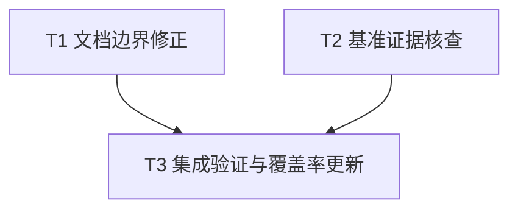

# rs-codec 评审意见修复与验证证据更新实施计划

> **面向智能体执行者：** 使用 executing-plans 按本计划逐项实施，以复选框跟踪进度。用户已要求直接生成方案，无需重复范围确认或方案审批；实际实施由后续实施命令授权启动。

**目标：** 完成三项已确认的文档／覆盖率问题，并对 RC-009 形成可复核、不过度推断的结论。

**架构：** 保留公共 API、运行行为和依赖。局部修正文档，使用已有 coverage 入口更新证据；RC-009 先验证再条件修改基准。

**技术栈：** Rust 1.94.0、Cargo、现有 rs-infra coverage 执行器、Criterion、SHA-256、`nm`、`objdump`。

**设计文档：** [本轮设计](design-20261030T151032239Z-7a98bc17.md)。

**工作位置：** `/data/working/qubit/rust-common/rs-codec`，沿用当前 Paseo workspace。本方案按用户指定路径保存，不创建技能默认的临时方案工作区。

## 采纳范围

| 条目 | 纳入任务 | 状态 |
| --- | --- | --- |
| RC-R2-001 | T3 | 已确认：覆盖率报告过期 |
| RC-R2-002 | T1 | 已确认：两份设计文档混淆边界 |
| RC-R2-003 | T1 | 已确认：incomplete hook Rustdoc 漏述 |
| RC-009 | T2、T3 | 待验证：六条基准路径的完整输出写入 |

本次用户没有限定采纳范围，按其指令默认纳入本轮全部意见。明确搁置或拒绝项：无。RC-009 纳入核查，不预设需要修复。

## 全局约束

- 在当前 Paseo workspace 内处理目标目录，不创建或打开新的 Paseo workspace。
- 仅修改与当前任务直接相关的内容，不顺手重构、格式化或清理。
- CI 只验证当前 crate 自身，不加入或保留 downstream all-features 测试。
- 不扩大为公共 API 重构、依赖／基础设施升级或下游迁移。
- 未确认的基准问题不作为已确认缺陷执行修复。

前三项为用户持续要求，后两项为本方案的最小改动决策。提交、推送按实施命令和当时适用的仓库规则处理；本计划不额外授予 Git 写操作权限，也不将方案生成阶段的边界写成实施禁令。

## 调度图

| 任务 | 前置任务 | 最小解锁产物 | 写入集合（相对目标仓库） | 本地验证 | 集成验证归属 | 审查时机 |
| --- | --- | --- | --- | --- | --- | --- |
| T1 文档边界修正 | 无；批次 A | 三份已核对文档，无接口提交依赖 | `doc/transcode_error_refactor_design.zh_CN.md`、`doc/decode_lifecycle_output_design.zh_CN.md`、`src/transcode/engine/transcode_decode_hooks.rs` | 对照实现逐段核对；`git diff --check` | T3 | 批量审查 |
| T2 基准证据核查 | 无；批次 A，与 T1 写入集合不相交 | 六条路径判定表及默认构建证据 | `benches/README.md`；条件修改 `benches/transcode.rs`；构建证据在 `target/review-7a98bc17/` | 默认 profile 的构建与机器码核查；条件测量 | T3 | 条件修正前立即审查证据，最终批量审查 |
| T3 集成验证与覆盖率更新 | T1、T2 | 前两任务的最终源码与核查结论 | `coverage-summary.md`、构建产物；仅具体行为缺口涉及的测试文件 | 当前 crate 的集成命令、报告摘要及源码映射核对 | T3 独占全量验证 | 立即审查 |

T1、T2 属于同一可并行批次，不要求新增子智能体；当前执行者可交错完成。所有 Cargo 重型命令共享 target 资源组，串行执行。若实施时另有明确授权使用并行执行者，仍须保持上述写入集合互斥。T3 在 T2 所有可能源码变更完成后生成最终报告。

## 任务拓扑依赖图



## T1：修正设计文档和 Rustdoc

**输入：** 当前实现及现有中英文用户指南。**输出：** 准确的调用边界说明；不改变接口或运行行为。

- [ ] 读取实施时 `git status --short` 和 `git log -1`，保留已有用户改动。复核 `src/transcode/transcoder.rs` 的完整驱动、`src/transcode/io/internal/transcode_progress_validation.rs` 的校验、`src/value/codec_value_lifecycle.rs` 的完整单值校验和 `src/transcode/io/internal/codec_decode_driver.rs` 的消费逻辑。
- [ ] 修改错误设计文档的进度错误段落和转换关系表，分别写明：直接校验返回 `TranscodeContractError`；完整转码默认驱动通过 `TranscodeFailure::InvalidProgress` 转为 `Self::Error`；I/O 校验返回 `io::Error(InvalidData)` 并保留契约错误 source。另说明 EOF 后 `NeedInput` 的 I/O 语义拒绝不保证 source 为契约错误，失败不等于回滚。
- [ ] 修改生命周期设计文档的 owned lifecycle 段落：只将 `TrailingInput` 约束归属于 `CodecValueDecoder` 的完整切片入口；I/O 单值入口保留其后输入以供下一次读取。保留 reset、main、finish 输出隔离和当前消费顺序。
- [ ] 将 `handle_incomplete_decode` 的 source 段落改成以下英文 Rustdoc，保留后续容量及策略说明：

```rust
    /// The engine calls this method only from `transcode_eof`. `source` is
    /// `Some` only when the codec returned an incomplete failure carrying a
    /// source, such as through [`crate::DecodeFailure::incomplete_with_source`].
    /// It is `None` when the available tail is shorter than
    /// [`Codec::MIN_UNITS_PER_VALUE`] and the codec was not called, or when the
    /// codec was called but returned [`crate::DecodeFailure::incomplete`]
    /// without a source.
```

- [ ] 对照 `doc/user_guide.md` 与 `doc/user_guide.zh_CN.md` 的 incomplete hook 说明，确认无需改写已有正确内容。检查本任务 diff 只包含以上段落；执行 `git diff --check`，预期退出 0。

本任务不新增仅重复文案的测试。Rustdoc 链接及完整构建验证归 T3。

## T2：核查 RC-009 并按证据处理

**输入：** `benches/transcode.rs`、`benches/README.md` 既有审计、当前工具链和 bench profile。**输出：** 六条路径逐项结论，以及必要时的最小基准修正。

- [ ] 为 `direct_transcode`、`complete_lifecycle`、`decode_engine`、`codec_adapter`、`output_window_32`、`output_window_1024` 建立逐项核查表：调用范围、写出范围、循环次数、观察点、默认产物归属依据、结论。不得从未观察完整输出直接推导写入被消除。
- [ ] 阅读相关命令和工具的适用规则；实际构建前记录 `rustc -Vv`、`cargo -V`、CPU／目标平台、当前提交、工作区差异和 bench 配置。构建日志及机器码证据保存至可再生成的 `target/review-7a98bc17/`，无需新建 Paseo workspace。
- [ ] 优先判断既有默认产物是否仍可用、基准源码及编译输入是否一致。需要新产物时至多进行一轮默认 profile 构建：

```bash
cargo bench --locked --bench transcode --no-run --message-format=json
```

预期退出 0。从 Cargo JSON 的 `compiler-artifact`（`target.name == "transcode"`）提取实际 executable 路径，不硬编码历史 hash。记录其 SHA-256，运行 `nm -S -C` 和 `objdump -Cd`，以实际路径为参数并保留完整输出。上述命令仅编译，不代表已经计时或已证明保留写入。

- [ ] 对照默认产物识别各闭包完整写出范围。只有存在新归属思路时才做一次辅助分析；辅助 profile、调试行表或单独 IR 中的结果不能直接当作默认 profile 的证明。若机器码仍无法归属，按设计停止重复构建，逐项记录 `Unresolved` 和限制。
- [ ] **条件步骤：** 仅当默认产物可归属且确认部分／全部写入被消除时，修改对应计时循环。完整输出路径在计时调用后加入：

```rust
            black_box(&output[..progress.written()]);
```

`complete_lifecycle` 使用实际长度：

```rust
            black_box(&output[..written]);
```

`codec_adapter` 使用其实际缓冲区：

```rust
            black_box(&adapter_output[..progress.written()]);
```

窗口路径必须在下一轮覆盖前加入：

```rust
                    black_box(&output[..progress.written()]);
```

保留已有进度观察和 fixture，沿用现有 `run_output_windows` 的完整片段观察模式。不新增生产禁止内联属性，不引入额外 checksum 负载。未证实问题的路径不因形式统一而修改。

- [ ] 若进行了条件修正，先在计时外核对 65,536 字节输出与 fixture 一致，窗口每轮核对该源范围与写出范围对应，源累计消费量和累计输出量均为 65,536。随后重建默认产物，验证完整写入保留，再进行以下对应分组测量：

```bash
cargo bench --locked --bench transcode -- transcoder
```

先根据 `criterion_group!` 和分组注册确认过滤表达式覆盖修改的路径；若实际命名变化，使用实际完整 benchmark 名称记录精确命令。分组测量中原基准与修正基准不能混作相同测量定义；无生产性能提升声明。无源码修正则不为填充结果而重新计时。

- [ ] 更新 `benches/README.md` 的当前 RC-009 结论，保留历史。每条路径写“完整写入已保留”“确认被消除并已修正”或“Unresolved”；记录 artifact hash、环境、命令及证据位置。执行 `git diff --check`，预期退出 0。

RC-009 核查可因证据不足结束，但条目仍须标为待验证，最终交付明确披露。不能将六条路径统一升级为“已通过”。

## T3：集成验证并生成当前覆盖率证据

**输入：** T1、T2 的最终文件。**输出：** 当前 crate 的真实验证结果、最终覆盖率报告和逐条闭环状态。

- [ ] 检查 diff 范围；生产 Rust 仅有预定 Rustdoc 修改，基准源码修改均有 T2 确认证据。若工具会改变额外文件，先阅读命令并遵循按需规则，避免无关重排。未修改 Rust 行为时不人为增加失败测试。
- [ ] 在目标 crate 根目录串行运行以下检查并记录命令、退出码及关键输出。任何命令失败均不得描述为通过；先判断是否由本轮变更引起，再处理本轮范围内原因：

```bash
cargo test --locked --all-features
cargo clippy --locked --workspace --all-targets --all-features -- -D warnings
```

```bash
RUSTDOCFLAGS='-D warnings' cargo doc --locked --no-deps --all-features
```

预期全部退出 0。第一条同时验证当前 crate 的 doctest，第三条验证更新后的 API 文档链接。若既有告警使 Clippy 无法通过，如实记录，不能顺手重构无关代码。无需另跑下游 all-features，也不添加下游 CI。

- [ ] 阅读 `./.infra/bin/coverage.sh` 及其实际解析到的执行器，确定 feature 配置、生成位置、工具版本及清理范围；只允许正常清理可重新生成产物。若执行器是共享工具，不修改其版本或复制一套新执行器。
- [ ] 在最终源码上运行现有入口：

```bash
./.infra/bin/coverage.sh
```

记录真实命令展开、feature 集和退出码。预期成功生成当前 crate 的报告。若入口未更新仓库根的 `coverage-summary.md`，从它本次真实生成的文本报告更新该文件，保留现有摘要／详情结构；不手工估算比例。不修改 `.infra/coverage/coverage.json` 的豁免或阈值来制造通过。

- [ ] 核对报告确实包含当前空输入 EOF 派发、EOF 专用验证、converter 的 fallible allocation 路径。关联现有 `tests/transcode/io/async_transcode_decode_input_tests.rs`、`tests/transcode/io/transcode_decode_input_tests.rs` 和 `tests/transcode/engine/transcode_convert_engine_allocation_tests.rs`；区分覆盖已命中、未命中、文件不在本次配置范围。只在确认具体相关行为缺口后，按项目 Rust 测试规则新增针对性回归，验证该行为后重新生成报告。
- [ ] 在 `coverage-summary.md` 记录生成时间、Git 基线和 dirty 状态、工具版本、真实命令／feature 集、退出码及本地产物或 CI artifact 的真实位置。禁止把本地生成描述成已经上传。
- [ ] 使用以下算法生成源码清单及摘要；将逐文件清单写入本次构建产物目录，在报告中记录汇总值、清单位置和算法。摘要在最后一次相关源码变化后生成：

```python
from pathlib import Path
import hashlib
import json

root = Path.cwd()
paths = set()
for directory in ('src', 'tests', 'examples', 'benches'):
    paths.update(p for p in (root / directory).rglob('*.rs') if p.is_file())
for name in ('Cargo.toml', 'Cargo.lock', 'rust-toolchain.toml',
             '.infra/coverage/coverage.json', '.infra/ci/cargo-matrix.json'):
    paths.add(root / name)
entries = [
    [p.relative_to(root).as_posix(), hashlib.sha256(p.read_bytes()).hexdigest()]
    for p in sorted(paths, key=lambda p: p.relative_to(root).as_posix())
]
encoded = json.dumps(entries, ensure_ascii=False, separators=(',', ':')).encode('utf-8')
evidence = root / 'target/review-7a98bc17'
evidence.mkdir(parents=True, exist_ok=True)
(evidence / 'coverage-source-manifest.json').write_bytes(encoded)
print(hashlib.sha256(encoded).hexdigest())
```

- [ ] 执行 `git diff --check`，核对报告数字与本次生成的 summary 一致、源码摘要与交付内容一致。若验证后又修改了相关源码，重新运行受影响的验证和 coverage；仅调整报告元信息不触发自引用重算。
- [ ] 给出逐项交付状态：RC-R2-001 的报告基线及覆盖配置，RC-R2-002 的两处边界，RC-R2-003 的两种 `None` 来源，RC-009 六条路径的真实判定。未解决项明确保留，未运行项注明原因。

## 完成标准与范围核对

- [ ] T1 覆盖 RC-R2-002、RC-R2-003，未改动公共签名和运行逻辑。
- [ ] T2 覆盖 RC-009，验证先于条件修正，证据不足未伪报关闭。
- [ ] T3 覆盖 RC-R2-001，并独占集成检查及最终 coverage 生成。
- [ ] 调度表、拓扑图和任务正文均只有 T1、T2、T3，依赖一致。
- [ ] 无明确排除项被重新纳入；无新增下游 CI、基础设施升级、依赖升级或无关清理。
- [ ] 真实通过、失败、未运行和未能确认分别报告；最终阶段操作遵循后续实施命令的授权。
